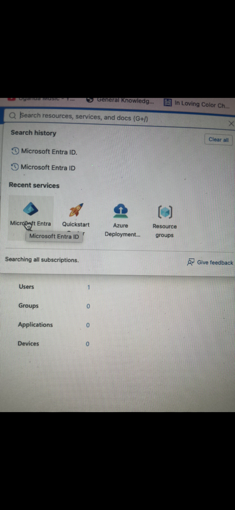
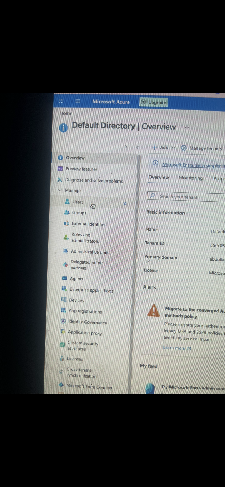
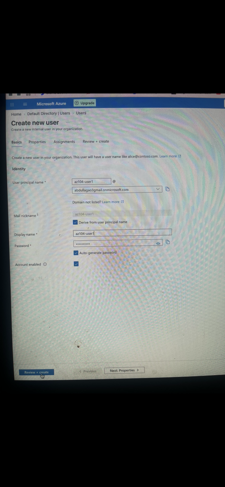
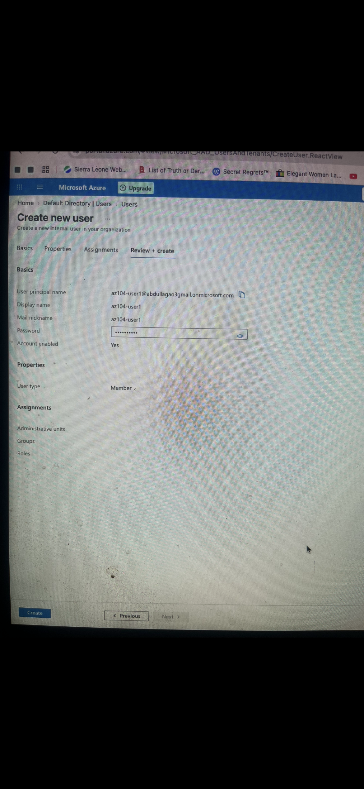
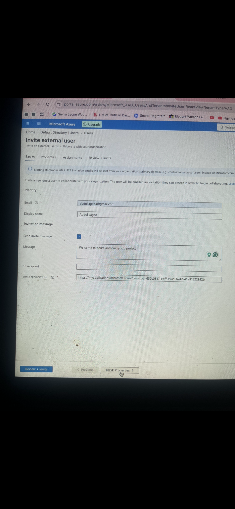
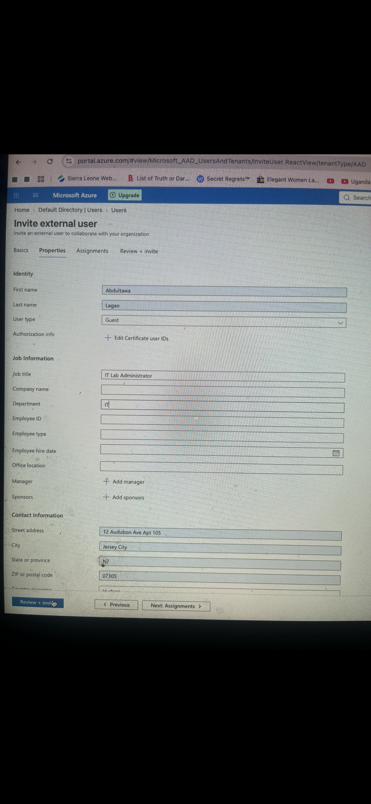
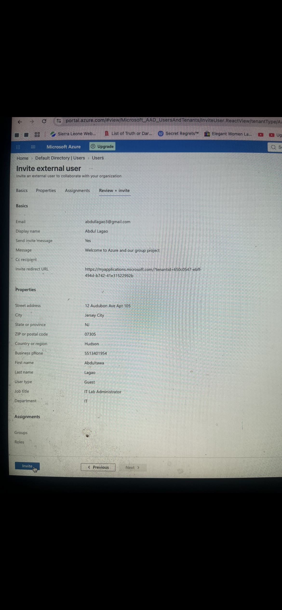

# Project: Microsoft Entra ID Identity & Access Management (AZ-104 Lab)

* **Author:** Abdultawa Lagao
* **Role:** Aspiring Cybersecurity Analyst | Azure Administrator | IT Support Specialist
* **Lab Reference:** Microsoft Learn AZ-104 Lab 01

---

## 🎯 Project Overview
In this project, I explored Microsoft Azure Administrator (AZ-104) Lab 01, focusing on configuring and managing identities within Microsoft Entra ID. The work covered everything from setting up user accounts and inviting external users to establishing and configuring security groups.

---

## 🛠️ Technologies Used
* Microsoft Azure & Azure Portal
* Microsoft Entra ID
* Identity and Access Management (IAM) & Security Groups
* Microsoft Copilot

---

## 🏗️ Implementation & Tasks

### Task 1: Create and Configure Users
* **Internal User Provisioning:** Set up new user accounts in Microsoft Entra ID, configuring parameters like User Principal Name, Display Name, Job Title, Department, Usage Location, and Account Status.
* **External User Management:** Tested Microsoft Entra ID's guest access feature by inviting an external collaborator to securely work with organizational resources.
### Task 1: Create and Configure Users
* **Internal User Provisioning:** Set up new user accounts in Microsoft Entra ID.
* **External User Management:** Invited an external guest user to collaborate.

#### Step 1: Locate Entra ID

#### Step 2: Access Directory Users

#### Step 3: Internal User Setup

#### Step 4: Review Internal User

#### Step 5: Invite Guest User

#### Step 6: Guest Job Properties

#### Step 7: Send Guest Invitation

### Task 2: Create and Manage Security Groups
* **Group Creation:** Created a Security Group named `IT Lab Administrators` to oversee users managing the IT lab environment.
* **Ownership & Membership:** Designated a group owner, added both internal and external guest users, and reviewed static group membership settings.
### Task 2: Create and Manage Security Groups
* **Group Creation:** Created a Security Group named `IT Lab Administrators` to aggregate user permissions efficiently.
* **Membership Assignment:** Added owners and assigned members to enforce role-based access control (RBAC).

#### Step 1: Locate Microsoft Entra ID

#### Step 2: Configure Group Basics

#### Step 3: Assign Group Owners

#### Step 4: Add Group Members

#### Step 5: Finalize Group Setup

#### Step 6: Verify in All Groups

#### Step 7: View Group Overview

---

## 🚀 Key Takeaways & Skills Gained
* Gained hands-on experience managing identities using Microsoft Entra ID.
* Learned how organizations handle employee identities, collaborate securely with external users, and organize individuals into security groups.
* Enhanced cloud identity management workflows through centralized cloud administration.

## 🛡️ Skills Demonstrated
* Microsoft Entra ID Administration & Azure Administration
* Identity and Access Management (IAM)
* User and Group Management
* Cloud Security Fundamentals & Azure Portal Navigation
