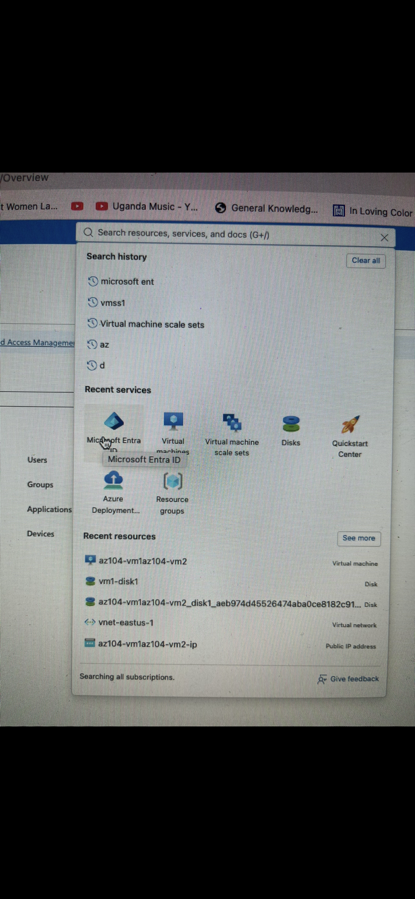
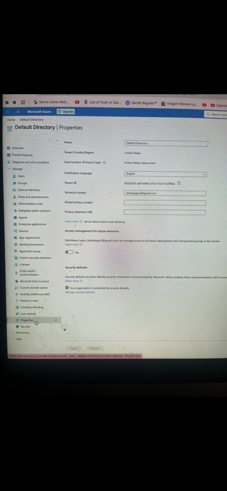
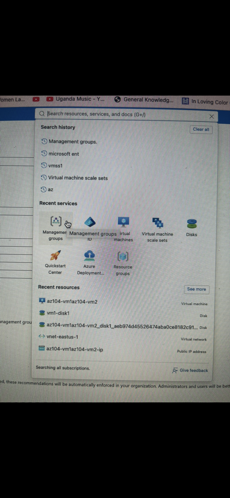
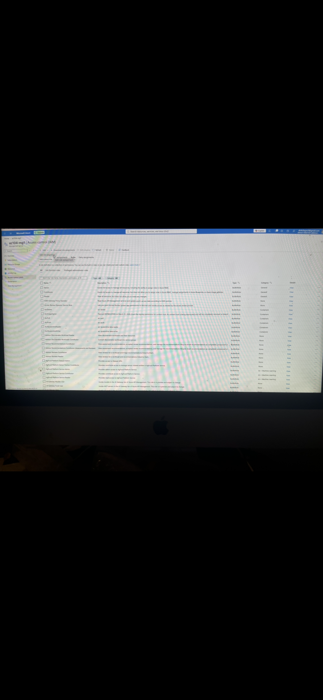
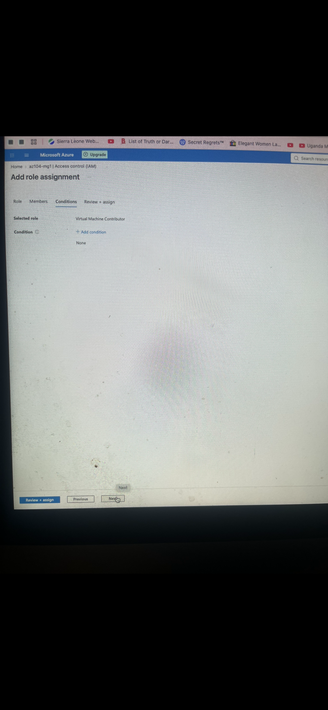

# AZ-104 Lab: Managing Subscriptions and RBAC

**Author:** Abdultawa Lagao  
**Role:** Aspiring Cybersecurity Analyst | Azure Administrator | IT Support Specialist  
**GitHub Profile:** https://github.com/abdul1738  
**Lab Reference:** [Microsoft Learn AZ-104: Manage Subscriptions and RBAC](https://microsoftlearning.github.io/AZ-104-MicrosoftAzureAdministrator/Instructions/Labs/LAB_02a_Manage_Subscriptions_and_RBAC_Entra.html)

---

## 📌 Project Overview

This project documents my hands-on experience completing Microsoft Azure Administrator (AZ-104) Lab 02a: Managing Subscriptions and Role-Based Access Control (RBAC) in Microsoft Azure and Microsoft Entra ID.

The lab focused on enterprise governance, structuring management groups, examining subscription permissions, and implementing fine-grained access control using built-in and custom RBAC roles.

---

## 🎯 Objectives

- Create and organize Azure Management Groups[span_0](start_span)[span_0](end_span)
- Inspect Azure subscription properties and cost structures
- Assign built-in Azure RBAC roles at various scopes[span_1](start_span)[span_1](end_span)
- Create custom RBAC roles for specialized administrative tasks[span_2](start_span)[span_2](end_span)
- Monitor role assignments with the Activity Log[span_3](start_span)[span_3](end_span)

---

## 🛠️ Technologies Used

- Microsoft Azure Portal[span_4](start_span)[span_4](end_span)
- Azure Management Groups[span_5](start_span)[span_5](end_span)
- Azure Subscriptions & Cost Management
- Role-Based Access Control (RBAC)[span_6](start_span)[span_6](end_span)
- JSON & Azure PowerShell / CLI concepts

---

## 👤 Task 1: Implementing Management Groups & Governance

I established a management group hierarchy to organize Azure subscriptions efficiently. This demonstrated how large organizations enforce governance policies and compliance across multiple subscription boundaries[span_7](start_span)[span_7](end_span).

---

## 👥 Task 2: Configuring Azure RBAC & Role Assignments

I explored Azure Role-Based Access Control (IAM) by assigning permissions at different scopes (Management Group, Subscription, and Resource Group). This emphasized the principle of least privilege, ensuring users only receive access required for their roles[span_8](start_span)[span_8](end_span).

---

## ⚙️ Task 3: Creating Custom RBAC Roles

I defined a custom role using granular permission sets. This showcased how administrators can extend Azure's built-in role library to fit unique organizational requirements[span_0](start_span)[span_0](end_span).

---

## 🔍 Task 4: Monitor Role Assignments with the Activity Log

I examined the Azure Activity Log to track and audit subscription-level events and monitor administrative role modifications across the management group hierarchy[span_10](start_span)[span_10](end_span).

---

## 🔐 Security Concepts Demonstrated

- Governance & Compliance Frameworks
- Role-Based Access Control (RBAC)[span_11](start_span)[span_11](end_span)
- Scope Inheritance & Delegation
- Principle of Least Privilege
- Multi-Subscription Management

---

## 📚 Key Takeaways

Through this lab, I gained practical knowledge of enterprise cloud governance. I learned how to structure administrative hierarchies, delegate permissions securely, and mitigate security risks through structured RBAC assignments[span_12](start_span)[span_12](end_span).

---

## 🚀 Skills Demonstrated

- Azure Governance & Hierarchy Management
- Identity and Access Management (IAM)
- Custom Role Authoring & Scope Administration[span_13](start_span)[span_13](end_span)
- Cloud Security Best Practices
